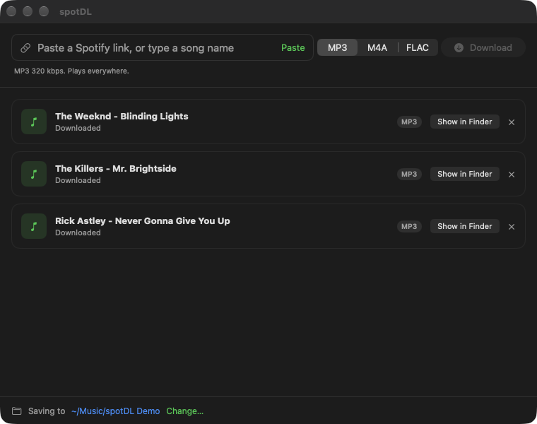

# spotdl-gui

A small native macOS app for [spotDL](https://github.com/spotDL/spotify-downloader). Paste a Spotify link, pick a format, and watch it download. No terminal needed.

> Unofficial. Not affiliated with spotDL or Spotify.



## Download

1. Download `spotDL-<version>.dmg` from the [Releases page](https://github.com/babbaranish/spotdl-gui/releases/latest).
2. Open the disk image and drag spotDL to Applications.
3. First launch: the app is not notarized, so macOS blocks it once. Open System Settings, go to Privacy and Security, scroll down and click Open Anyway.

Or, in Terminal:

```bash
xattr -dr com.apple.quarantine /Applications/spotDL.app
```

Optional: check the download against its checksum file (run it in the folder with both files):

```bash
shasum -a 256 -c spotDL-<version>.dmg.sha256
```

## Features

- One window that stays open. Paste a song, album, playlist or artist link, or just type a song name.
- A download queue: keep adding links while others download. They run one at a time so Spotify does not rate limit you.
- Paste several links at once (separated by spaces or new lines).
- MP3 (320 kbps), M4A (original audio) or FLAC.
- Live progress per job ("Downloading 12 of 32"), plus a per-song list showing what finished, what was already downloaded and what failed.
- Retry only re-downloads the songs that are missing.
- Copy a Spotify link, switch back to the app, and it is already filled in.
- Playlists and albums get their own folder. Choose where files are saved (default `~/Music/spotDL`).
- Dock badge with the number of active downloads, a sound when a job finishes, and a warning before quitting mid-download.

## Requirements

- macOS 14 or later, Apple Silicon or Intel
- [spotDL](https://github.com/spotDL/spotify-downloader) and ffmpeg

Install spotDL and ffmpeg:

```bash
brew install ffmpeg uv
uv tool install spotdl --python 3.12
```

The app looks for `spotdl` in `~/.local/bin`, `/opt/homebrew/bin` and `/usr/local/bin`.

## Build from source

You need the Xcode Command Line Tools: `xcode-select --install`

```bash
git clone https://github.com/babbaranish/spotdl-gui.git
cd spotdl-gui
make install
```

`make install` builds the app and copies it to `/Applications/spotDL.app`.

- `make app` builds `build/spotDL.app` without installing it.
- `make dmg` builds the disk image in `dist/`.
- `make help` lists every target.

## How it works

The code is split into two parts:

- `Sources/Core`: spotDL output parsing, commands and other pure logic. Unit tested.
- `Sources/App`: the SwiftUI window, the download queue and process handling.

For each job it runs:

```
spotdl download <link> --format <fmt> --output <template> --simple-tui
```

and reads spotDL's output line by line to show progress. Nothing is sent anywhere except by spotDL itself.

For testing, two environment variables are supported when launching the binary directly:

- `SPOTDL_GUI_AUTOADD`: a link or search to queue on launch
- `SPOTDL_GUI_OUTDIR`: a save folder for this run only (not remembered)

## Development

- `make test` runs the unit tests.
- [CONTRIBUTING.md](CONTRIBUTING.md) covers the code layout, pull requests and releases.

## Notes

- Audio comes from YouTube Music, so quality depends on what YouTube serves.
- If Spotify rate limits spotDL, the job says so. Wait a few minutes and press Retry.
- Only download music you have the right to download.

## License

MIT. See [LICENSE](LICENSE).
